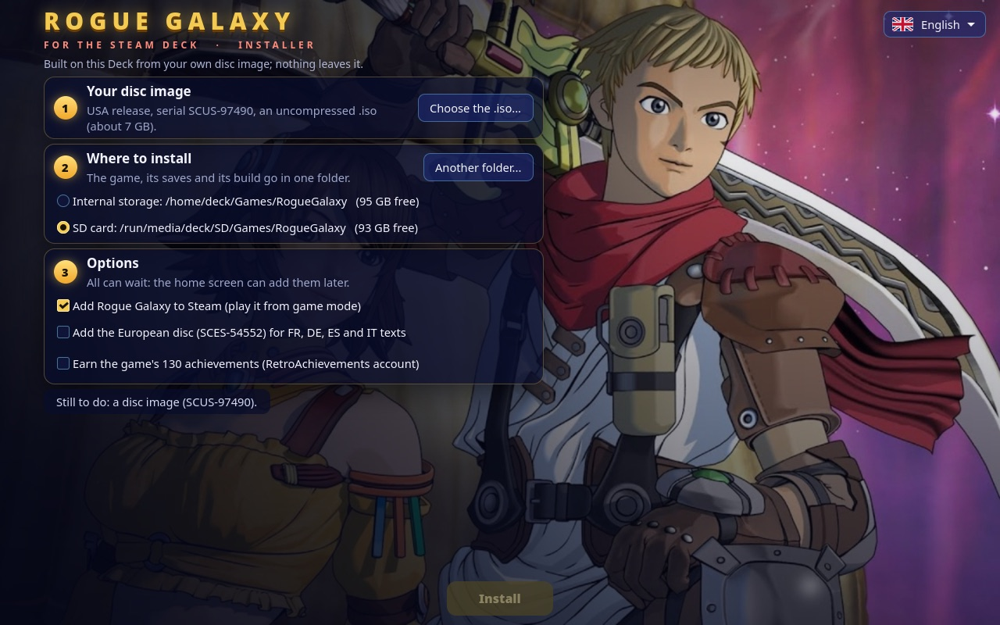
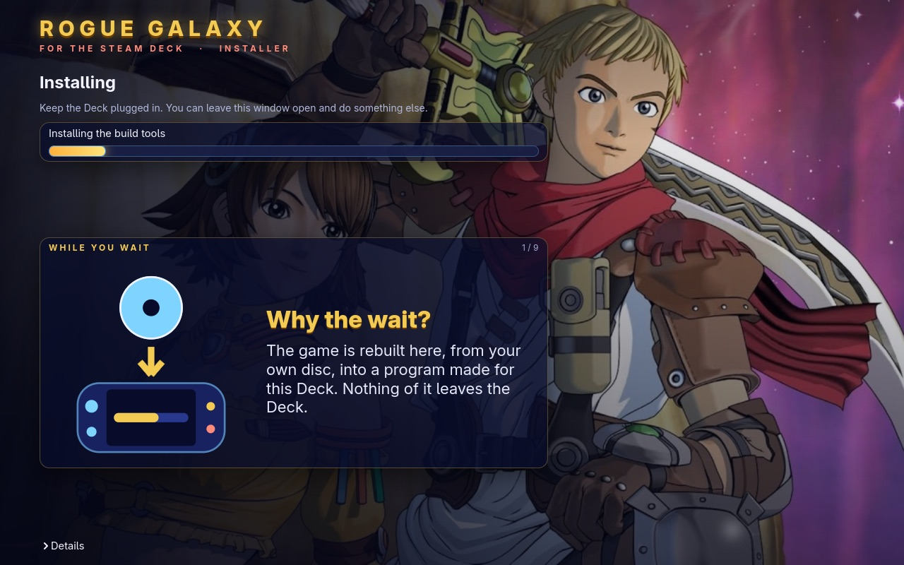
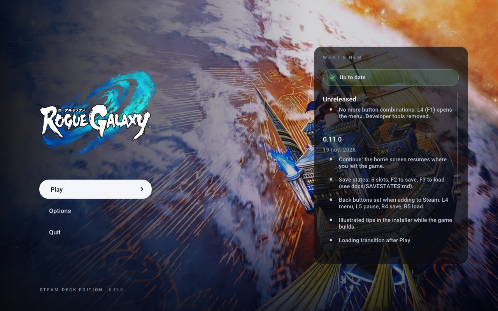
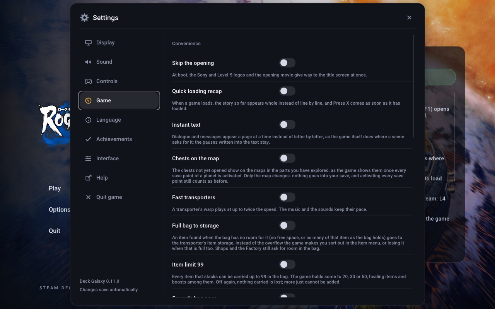
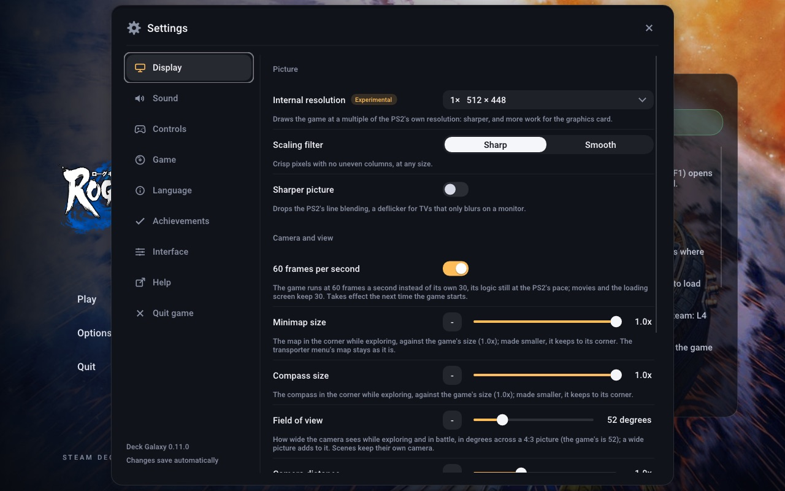

  

<h1 align="center">Deck Galaxy</h1>

  <b>Rogue Galaxy, as a native game on your Steam Deck.</b> 
  60 fps, 16:10, save states and a one-click installer. Built from your own disc.

  
  
  
  

  <a href="#-install">Install</a> ·
  <a href="#-features">Features</a> ·
  <a href="#-screenshots">Screenshots</a> ·
  <a href="#-controls">Controls</a> ·
  <a href="#-help">Help</a> ·
  <a href="docs/README.md">Docs</a>

---

**Rogue Galaxy** (Level-5 / SCE, PlayStation 2, USA release SCUS-97490) is
statically recompiled into a program made for the Steam Deck, on
[PS2Recomp](https://github.com/ran-j/PS2Recomp) ([how it works](docs/HOW-IT-WORKS.md)).
It is built on your Deck from **your own disc image**: nothing of the game is
distributed, and the Steam Deck (SteamOS) is the only machine supported.

## ✨ Features

|  |  |
|---|---|
| 🚀 **60 fps** | Twice the original's 30, logic kept at the PS2's pace. |
| 🖥️ **Made for 16:10** | The picture fills the Deck's screen. |
| 💾 **Save states** | Five slots, saved and loaded in one press, even after closing the game. |
| ▶️ **Continue** | The home screen takes you back to where you left the game. |
| 🏆 **Achievements** | The game's 130 [RetroAchievements](docs/RETROACHIEVEMENTS.md). |
| 🎌 **Japanese voices** | The undub: Japanese voices and movies, from your own Director's Cut disc. |
| ⚔️ **Director's Cut** | Its [battle balance, enemy behavior and party AI](docs/DIRECTORS-CUT.md), as options. |
| 🌍 **More languages** | French, German, Spanish or Italian text, from the European disc (experimental). |
| 🎨 **Texture packs** | [PCSX2's packs](docs/TEXTURE_PACKS.md) work. |
| 🔄 **Updates in the game** | Update from the home screen, nothing to download by hand. |
| 🎛️ **Many options** | Instant text, chests on the map, faster transporters... [All of them](docs/OPTIONS.md). |

## 📥 Install

You need about **24 GB** free (the SD card is fine), an internet connection
and your own uncompressed `.iso` of Rogue Galaxy USA (SCUS-97490).

1. In **desktop mode**, download `RogueGalaxy-Setup-x86_64.AppImage` from the
   [releases](../../releases) page and double-click it.
2. Pick your disc image and where to install, then press **Install**. The
   game is built on the Deck in 10 to 30 minutes and added to Steam.
3. Switch to **game mode** and play. Nothing else needs desktop mode, and the
   installer is not needed again.

  
  

SteamOS has no compiler, so the build runs in a container (distrobox) that the
installer sets up itself. More in [docs/INSTALL.md](docs/INSTALL.md) and
[docs/BUILDING.md](docs/BUILDING.md#steam-deck).

## 🧪 Playtest progress

The game is played through on a real Steam Deck, chapter by chapter, to catch
bugs the recompilation may have. This table is updated as the playthrough goes.

| Chapter | Status | Settings used | Notes |
|---|---|---|---|
| 1 | ✅ Tested | French text, 2x, 60 fps, sharp filter, instant text, opening skipped, bag 99. English voices, no Director's Cut. | No bug found. |
| 2 | ✅ Tested | Same as chapter 1. | No bug found. |
| 3 | ⏳ TBD | | |
| 4 | ⏳ TBD | | |
| 5 | ⏳ TBD | | |
| 6 | ⏳ TBD | | |
| 7 | ⏳ TBD | | |
| 8 | ⏳ TBD | | |
| 9 | ⏳ TBD | | |
| 10 | ⏳ TBD | | |
| 11 | ⏳ TBD | | |
| 12 | ⏳ TBD | | |
| 13 | ⏳ TBD | | |
| Bonus: Alistair | ⏳ TBD | | |
| The Ghost Ship | ⏳ TBD | | |

**Settings used**: the options that can change the result (language, fps, 2x resolution, voices, Director's Cut...).

✅ tested, no bug · ⚠️ tested, known bug (see [issues](../../issues)) · ⏳ TBD, not tested yet.

## 📸 Screenshots

The home screen has **Play** (or **Continue**), **Options** and **Quit**, and
"What's new" with the update beside them.

  

**L4** opens the menu in the game (**Options** on the home screen): display, sound,
controls, the game's options, language, achievements and more, all reachable
with the controller. Changes save by themselves.

  
  

Every option, and where it is: [docs/OPTIONS.md](docs/OPTIONS.md).

## 🎮 Controls

In game mode the Deck works as a gamepad (Steam's default layout for a
non-Steam game). The Steam button stays Steam's.

| Deck | PS2 pad | | Deck | PS2 pad |
|---|---|---|---|---|
| Left stick / D-pad | Left stick / D-pad | | L1 / R1 | L1 / R1 |
| Right stick | Right stick | | L2 / R2 | L2 / R2 |
| A / B / X / Y | ✕ / ○ / ▢ / △ | | L3 / R3 | L3 / R3 |
| Menu / View | Start / Select | | | |

The back buttons are set when the installer adds the game to Steam:

| Button | Does |
|---|---|
| **L4** | Opens the menu (F1) |
| **L5** | Pauses (F5) |
| **R4** | Saves a state (F2) |
| **R5** | Loads a state (F3) |

Everything can be changed in the menu, Settings > Controls. In the menu, A
opens a page, B goes back, L1 and R1 turn the pages.

## 🩺 Help

This is a work in progress. The whole game plays, but expect bugs: graphics
glitches, slowdowns, maybe a freeze. Save often, in more than one slot, and
back up `disc/mc0` (your saves) now and then. **Only the USA disc** works.

- Known issues: the [CHANGELOG](CHANGELOG.md). What is being worked on:
  [docs/STATUS.md](docs/STATUS.md).
- **Found a problem?** Open an [issue](../../issues/new/choose): its form asks
  what you were doing, the version (menu > Help > About) and
  `build/last-run.log` (the run before is `build/last-run.prev.log`). The
  rules for issues and pull requests are in [CONTRIBUTING.md](CONTRIBUTING.md).

## 📚 Learn more

Every page, by who it is for: [docs/README.md](docs/README.md).

- [docs/INSTALL.md](docs/INSTALL.md): installing, the undub, the European texts, updating
- [CHANGELOG.md](CHANGELOG.md): each release
- [docs/OPTIONS.md](docs/OPTIONS.md): every option
- [docs/SAVESTATES.md](docs/SAVESTATES.md): the five slots
- [docs/HOW-IT-WORKS.md](docs/HOW-IT-WORKS.md): the project in plain words
- [docs/BUILDING.md](docs/BUILDING.md): building by hand
- [docs/HOOKS.md](docs/HOOKS.md): changing the game's behaviour

## ⚖️ Legal

You must own the game. No game data, BIOS or disc-derived files are part of
this repository: `disc/` and disc images are gitignored and must never be
committed. The installer's and home screen's artwork is official promotional
artwork, the property of its owners.

## 🙏 Credits

- [PS2Recomp](https://github.com/ran-j/PS2Recomp) by ran-j, and the
  [fork](https://github.com/Sinan-Karakaya/PS2Recomp) by Sinan Karakaya.
- [rogue-galaxy-recomp](https://github.com/victor-takai/rogue-galaxy-recomp)
  by victor-takai, the project Deck Galaxy comes from.
- [DQ8-Recompiled](https://github.com/Sinan-Karakaya/DQ8-Recompiled) by Sinan
  Karakaya, the reference for MWo3 overlays on PS2Recomp, and the source of
  the SDL3 GPU GS backend and the in-game menu in `thirdparty/dq8-gfx`.
- [Dear ImGui](https://github.com/ocornut/imgui) by Omar Cornut (MIT), which
  the menu is drawn with, and its Roboto Medium font (Apache 2.0).
- [Lucide](https://lucide.dev) (ISC; its check from Feather, MIT), whose
  gamepad-2, keyboard, rotate-ccw and check icons the menu's controller,
  keyboard, undo and check follow (`thirdparty/dq8-gfx/LICENSE-lucide.txt`).
- [RGDecomp](https://github.com/Dorgengoa/RGDecomp) (CC0), the function maps
  and names for this build (`config/SCUS_974.90/functions_*.csv` derive from
  it).
- [Redump](http://redump.org/disc/6567/) and [PCSX2](https://github.com/PCSX2/pcsx2)
  (GameDB, patches) for disc and hardware notes.

## 📄 License

GPL-3.0, the same as PS2Recomp, which the built executable links. See
[`LICENSE`](LICENSE).
