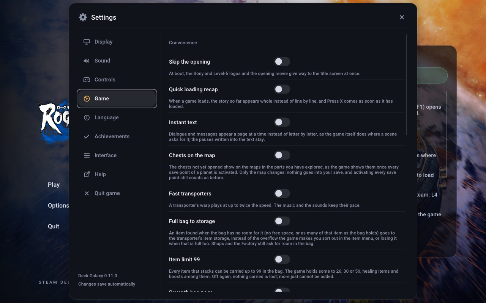

# Options

**F1** opens the menu: one window in the middle of the screen, with a list of
pages on the left. There is no bar along the top. The Guide button (L4
on the Deck, through its Steam Input layout) opens the same window; L1 and R1 turn its
pages.

With only a controller (the menu names its buttons as the controller does:
A and ✕ are the same button, B and ○, X and ▢, Y and △):

- In the page list, A or Right goes into the page; moving along the list
  shows each page.
- B comes back one level at a time: out of a slider or a list, then from
  the page to the page list, and from the page list to the game.
- L1 and R1 turn the pages, the left stick moves like the D-pad and the
  right stick scrolls.
- A strip along the bottom of the window names the buttons for where the
  cursor is.
- "Quit game", at the end of the page list, asks first.
- On Controls, X clears a binding. While one is being set, a tap of B binds
  B and holding it cancels.

The menu has ten pages, written here as F1 > Game and so on:

- **Save states**: the five slots to save into on the left, the five to
  load from on the right, each with its picture and time; a used slot asks
  before it is overwritten. Choosing one closes the menu and does it. Not on
  the home screen.
- **Actions**: pause, fast-forward and its speed, mute, screenshots (take one, take one with the menu, open the
  folder) and the renderer statistics. Not on the home screen.

- **Display**: internal resolution (1x or 2x, 2x by default; the Deck's
  screen is 800 lines, the PS2's picture 448), scaling filter (Sharp or
  Smooth) and **Sharper picture**, which drops the PS2's line blending (it
  only blurs on a monitor). The window and the vertical sync are the
  system's: the game always starts fullscreen on the Deck.
- **Sound**: the volume.
- **Controls**: the controller's buttons (remapping), the sticks' dead zone,
  the triggers' threshold and the camera's inversion. The Deck's own
  controller is the only one; there is no keyboard or mouse page.
- **Game**: the game options below.
- **Language**: the menu's language (the Deck's to begin with; English,
  French, German, Spanish or Italian: the home screen and the menu), the
  game's text language and the undub, [below](#language).
- **Achievements**: the account and the list.
- **Interface**: the menu's size, notifications, pause and fast-forward.
  "Pause in the background" (on by default) stops the game while its window is
  not in front.
- **Help**: the shortcuts, the project page, where to report a problem, and
  About.

An option that does nothing as things stand stays on its page, greyed
out, with a line under it saying what would make it work: the undub until
`setup.py extract-japanese` has read your Japanese disc, a language of Game language
whose files are missing.

| Key | |
|---|---|
| F2 | Save: the five slots, to pick where (see [SAVESTATES.md](SAVESTATES.md)) |
| F3 | Load: the five slots, to pick which |
| F5 | Pause |
| F4 | Fast-forward |
| F6 | Free camera |
| F12 | Take screenshot |

## Game options

F1 > Game, in these sections, except **Camera and view**, which is on F1 > Display,
and **Check for new versions**, which is on F1 > Interface:

**Camera and view** (F1 > Display)

| Option | |
|---|---|
| Remaster mode | On by default. Modernizes the native renderer with mipmaps, 16x anisotropic filtering, smooth palette textures and contrast-adaptive sharpening (CAS). Turn off for the original PS2 texture rendering. |
| 60 frames per second | On by default; off, the game's own 30. From the next start. |
| Minimap size | 0.5x to 1.0x the game's, toward its corner. |
| Compass size | 0.5x to 1.0x the game's, toward its corner. |
| Field of view | 40 to 90 degrees (the game's is 52). |
| Camera distance | 0.7x to 1.6x the game's. |
| Faster camera rotation | The camera turns twice as fast. |
| Draw distance | 1.0x to 4.0x the game's, from the next map loaded. |
| Free camera (F6) | The party stands still and the controller moves the camera. Start or F6 to leave. |

**Convenience**

| Option | |
|---|---|
| Skip the opening | Straight to the title screen. |
| Quick loading recap | The story so far appears whole, and you can go on as soon as it has loaded. |
| Instant text | Dialogue a page at a time instead of letter by letter. |
| Skip spell animations | The scene of a spell or special move is skipped as soon as the game allows it, as if its skip button were pressed. |
| Chests on the map | Unopened chests show on the map in the parts explored. |
| Fast travel from the map | With the map open (Select), the d-pad chooses among the transporters activated on the planet and the confirm button travels to the one chosen. |
| RetroAchievements | The game's 130 RetroAchievements are checked as you play. On the Achievements page, with the account (sign in, sign out) and the list. |
| Fast transporters | Transporter warps play up to twice as fast. |
| Check for new versions | At each start, asks GitHub for this project's releases and says when a newer one is out (Rogue Galaxy > About links to it). On by default. |
| Full bag to storage | An item found when the bag has no room for it goes to the transporter's item storage, instead of the overflow you have to sort out (or losing it when that is full too). Shops and the Factory still need room in the bag. |
| Item limit 999 | Every item that stacks can be carried up to 999 in the bag; the game holds some (healing items, boosts) to 20, 30 or 50. |
| Seventh bag page | The bag holds 280 items instead of 240; the transporter's storage keeps its 320. A save made with it loads without it too, the seventh page's items kept out of sight until it is back on. From the next start. |

**Battles and rewards**

The numbers are against the game's own, 1.0x.

| Option | |
|---|---|
| Encounter rate | 0.0x (no random battles) to 3.0x. |
| Experience from battles | 0.0x to 5.0x. |
| Money from battles | 0.0x to 5.0x. |
| Item drops | 0.0x to 10.0x. |
| Weapon growth | 1.0x to 10.0x: each battle fills a weapon's gauge (15 to full), then its attributes, by 1 point, or more. |
| Shop prices | 0.1x to 2.0x. |
| Action gauge speed | 0.25x to 4.0x. |
| Director's Cut balance | Off by default. Turns on the battle balance of the Japanese Director's Cut (SCPS-17013); what it changes: [DIRECTORS-CUT.md](DIRECTORS-CUT.md#balance). Needs your Japanese disc: run `setup.py extract-japanese` (it serves all three Director's Cut options). Takes effect at the next start. |
| Director's Cut enemy behavior | Off by default. Turns on the enemies' attacks and AI of the same release ([DIRECTORS-CUT.md](DIRECTORS-CUT.md#enemy-behavior)), with or without the balance. Needs the same disc. Takes effect at the next start. |
| Director's Cut party AI | Off by default. Turns on the allies' AI of the same release ([DIRECTORS-CUT.md](DIRECTORS-CUT.md#party-ai)). Needs the same disc. Takes effect at the next start. |

## Language

F1 > Language. The menu's own language is there too, in the Menu section.

| Option | |
|---|---|
| Game language | English (the game's), Français, Deutsch, Español or Italiano: the menus, scenes and battles in that language of the European release, from your own European disc (SCES-54552). Needs that disc's texts in `disc/EU`: add your European disc image on the installer's Options page, or drop it onto the file; by hand, `python setup.py extract-european --iso "<your European disc>"`. A few lines the European disc has no words for stay English. Until you pick one, it starts as the Deck's language (Steam's, else the system's) when that language is installed. Takes effect at the next start. |
| Undub (Japanese voices) | The voices in scenes and the movies come from your own Japanese Director's Cut (SCPS-17013) instead of the English ones; the text stays as it is. Needs that disc's files in `disc/JA`: add your Japanese disc image on the installer's Options page, or drop it onto the file; by hand, `python setup.py extract-japanese --iso "<your Japanese disc>"`. A few lines (63) have no Japanese voice and play silent. Takes effect at the next start. |

## In the game's own menu

Most of the same options are on the game's Settings screen (System >
Settings in the main menu): L1 and R1 turn the page, and a number's - and
+ buttons lower and raise it. With the text in French, German, Spanish or
Italian, the options are named in that language there too. Check for new
versions, the three Director's Cut options, the text's language and the
undub are in F1 alone.

  
  

## Good to know

- The window opens as you left it. Settings are saved in
  `~/.local/share/RogueGalaxy/Recompiled/settings.ini`, screenshots in
  `~/.local/share/RogueGalaxy/Recompiled/screenshots` (Actions > Open
  screenshots folder). They are the same for every install on the Deck.
- The Deck's screen is 60 Hz (the OLED 90 Hz): 60 fps fits it.
- Each option also has an environment variable, for testing:
  [DEVELOPMENT.md](DEVELOPMENT.md).
